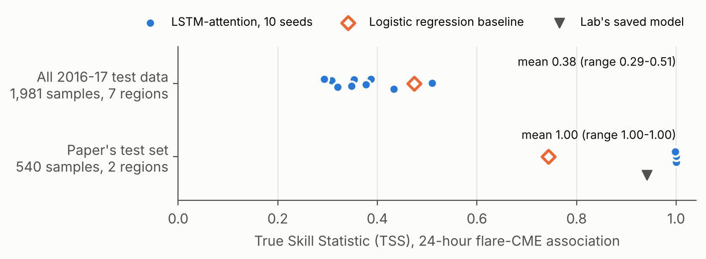
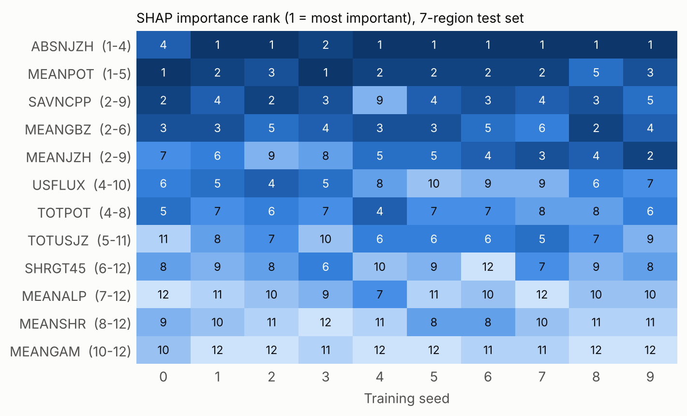
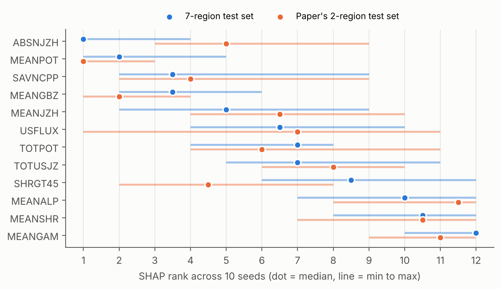
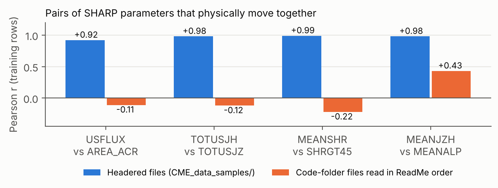

# How stable are SHAP explanations of an LSTM flare–CME predictor?

*Saad Shafqat · MS Computer Science, NJIT (starting Spring 2027)*

A small replication-and-robustness study built on public code and data from Jason T. L. Wang's group at NJIT:

- **Model and data:** Liu, Liu, Wang & Wang, *Predicting Coronal Mass Ejections Using SDO/HMI Vector Magnetic Data Products and Recurrent Neural Networks*, ApJ 890:12 (2020). [Paper](https://arxiv.org/abs/2002.10953) · [code and data](https://github.com/deepsuncode/RNN-CME-prediction) (MIT license).
- **Explainability study it follows:** Rawashdeh, Wang & Herbert, *Explainable AI in Deep Learning-Based Prediction of Solar Storms*, FLAIRS-38 (2025). [arXiv:2508.16543](https://arxiv.org/abs/2508.16543).

The question is narrow: **if you retrain the same model with a different random seed, or explain it on a different test set, do the SHAP feature rankings stay the same?** Physicists may read those rankings as physical insight, so their stability matters.

> Status: a student project, completed in November 2026. I am not a solar physicist, and I may have misunderstood parts of how the original files were used. Corrections are welcome.

## Main results

| | Result |
|---|---|
| Test set used in the FLAIRS paper | 540 samples from **2 active regions** (NOAA 12497, all negative; 12529, all positive) |
| TSS on that set | **1.00** for all 10 retrained seeds (0.998–1.000); 0.94 for the lab's saved model |
| TSS on all 2016–17 test data (7 regions, 1,981 samples) | **0.38 ± 0.07** across 10 seeds (0.29–0.51); logistic-regression baseline 0.47 |
| Top SHAP feature, 7-region set | ABSNJZH in 8 of 10 seeds, MEANPOT in 2 |
| Rank agreement between seeds (mean Kendall τ) | 0.64 (lowest pair 0.45) on the 7-region set; 0.54 (lowest 0.09) on the 2-region set |
| Same model, 2-region vs. 7-region explanation | Kendall τ 0.45–0.79; top feature changes from ABSNJZH to MEANPOT |
| Correlated features | USFLUX, TOTPOT and TOTUSJZ (pairwise r ≥ 0.89) each rank #4 or lower, but as a group they rank #1 in 3 of 10 seeds |



**1. A perfect score on two regions is not a stable estimate of skill.** Each of the paper's two test regions has a single label, so a model only needs to tell those two regions apart. On all seven 2016–17 regions the same models score TSS 0.29–0.51. Resampling whole regions (the realistic unit, since samples are 12 minutes apart) gives per-seed 95% intervals of roughly 0.0 to 0.8. A logistic regression on the last time step scores 0.47.



**2. The top of the ranking is fairly stable; the middle is not.** ABSNJZH and MEANPOT are consistently near the top and MEANGAM consistently last. SAVNCPP and MEANJZH move between rank 2 and rank 9 depending only on the seed.



**3. The explanation depends on which regions you explain.** For the same trained model, ranks computed on the 2-region set differ from those on the 7-region set. SHRGT45 has a median rank of 4.5 on the 2-region set and 8.5 on the 7-region set.

**4. Grouping correlated features changes the picture but does not stabilize it.** I cluster the 12 features by |r| on the training data (average linkage, cut at 0.9), which gives 6 groups (see `results/shap_summary.json`), and sum SHAP values within each group. The flux group (USFLUX + TOTPOT + TOTUSJZ) becomes the top group in 3 of 10 seeds. Agreement between seeds on the group ranking is lower, though (mean τ 0.36), so grouping hides some of the split credit without making the explanation more stable.

Permutation importance agrees on the top features: permuting ABSNJZH lowers AUC by 0.15 on average, MEANPOT by 0.10. Permuting TOTUSJZ, MEANGAM or MEANSHR slightly *raises* AUC on average, which fits a shift between the 2010–15 training period and the 2016–17 test period.

## A note on the data files



While checking the 2-region test set, I found that the headerless CSVs in the repo's `CMEpredict/` folder do not store the 18 SHARP parameters in the order their ReadMe lists. Matching every labelled row against the headered files in `CME_data_samples/` (same timestamp and region; values identical to 1e-15) shows that **17 of the 18 columns hold a different parameter than the ReadMe says**. `scripts/check_column_order.py` reproduces this in a few seconds.

Two checks suggest the headered files carry the correct names:

- Pairs that physically move together, such as total unsigned flux vs. region area (r = +0.92) and the two total-current measures (r = +0.98), are strongly correlated in the headered files. They are near zero when the code-folder files are read in ReadMe order.
- The six feature correlations quoted in the FLAIRS 2025 text (for example "TOTPOT and SAVNCPP … correlation value of 1", "MEANALP and USFLUX … −0.97") all reproduce within 0.03 when the 540-sample code-folder test file is read in ReadMe order. They do not reproduce with the headered files. Under the recovered order, that TOTPOT–SAVNCPP pair is SHRGT45–MEANSHR, two shear measures that are expected to be near-identical.

This does not affect the model's predictions, only which physical names its features carry. It is consistent with the published feature names being shifted, but I have not seen the analysis code behind the paper, so I can't confirm it. **All results in this repo use the headered files' names.**

## What I did

1. **Data** (`scripts/get_data.sh`): downloads the repo at commit `ee455eb`. Training data covers 2010-05 to 2016-01 (33,604 samples, 151 regions); test data 2016-02 to 2017-09 (1,981 samples, 7 regions, none shared with training).
2. **Model** (`src/model.py`): a PyTorch port of the LSTM-attention network in `CMEpredict.py`: LSTM(10) → attention → Dense(100) → sigmoid. Same 12 features, same 20-step sequences, 20 epochs, batch 256, RMSprop, balanced class weights, 0.45 threshold.
3. **Training** (`src/train.py`): 10 seeds; TSS and HSS on both test sets; 95% TSS intervals by resampling whole regions; a logistic-regression baseline; the lab's saved predictions.
4. **Explanations** (`src/explain.py`): `shap.GradientExplainer` with 200 training sequences as background, applied to every test sequence. A feature's importance is mean |SHAP| summed over the 20 time steps. Kendall τ between seeds; correlation groups (average linkage on |r|, cut at 0.9); grouped SHAP; permutation importance (AUC drop, 5 repeats).

## Limitations

- **Not an exact replica.** PyTorch has no recurrent dropout, so only input dropout is used. The original script's quality filters, written for raw values, are not applied to the normalized data. The paper's attention-LSTM may also differ in details from the public script.
- **Seven test regions is still very few.** The intervals above are wide, and the 2016–17 period is the declining phase of solar cycle 24.
- **One explainer.** I used gradient-based SHAP, as in the paper. A dependence-aware Shapley method (for example Aas et al., 2021) is the natural next step for correlated features.
- **Summing SHAP within a group** is a common approximation, not the exact Shapley value of the group.

## Reproduce

```bash
pip install -r requirements.txt   # tested with torch 2.15, shap 0.54, pandas 3.0, Python 3.13
bash scripts/get_data.sh
python scripts/check_column_order.py     # data note, a few seconds
python src/train.py                      # about 15 minutes on a laptop CPU (10 seeds)
python src/explain.py                    # about 20 minutes
python src/figures.py
```

Outputs go to `results/` (CSV and JSON) and `figures/`.

## Credits

The data, the original model and the research questions all come from the work cited above. Any errors in this re-analysis are mine.
